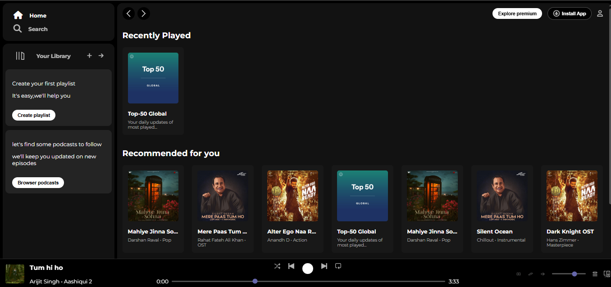

# 🎵 Spotify Clone (PRO)



[](https://spotify-clone-jahanzaib.netlify.app/)
[](https://developer.mozilla.org/en-US/docs/Glossary/HTML5)
[](https://developer.mozilla.org/en-US/docs/Web/CSS)
[](#)

> A modern, high-fidelity Spotify Web Player clone built with Semantic HTML5, Vanilla CSS3, and JavaScript. Featuring a premium dark aesthetic, full cross-device responsiveness, and smooth UI animations.

---

## 📖 Overview

The **Spotify Clone (PRO)** is a meticulously designed replica of the Spotify web interface. It was built to demonstrate advanced CSS Grid and Flexbox layouts, modern glassmorphism techniques, and a mobile-first responsive architecture.

**What makes it unique?**
- **Floating Mini Player**: A sleek, mobile-optimized music control bar that floats above the navigation for maximum usability.
- **A to Z Responsiveness**: Custom-tailored layouts for 360px (Mobile), 768px (Tablet), 1366px (Laptop), and 1920px (4K Screens).
- **Glassmorphism UI**: High-end blurred backgrounds and translucent panels for a premium feel.
- **Reveal Animations**: Content smoothly fades and slides into view as the user scrolls.

**Live Site**: [Spotify Clone Live Demo](https://spotify-clone-jahanzaib.netlify.app/)

---

## ✨ Features

- 🎨 **Modern Aesthetics** - Deep dark mode with Spotify Green accents and vibrant card designs.
- 📱 **Mobile-First UX** - Dedicated mobile navigation bar and a simplified playback interface for small screens.
- ⚡ **Performance Optimized** - Pure CSS and Vanilla JS for lightning-fast load times and zero dependency bloat.
- 🖼️ **Dynamic Card Grid** - Fluid CSS Grid layout that adapts the number of cards based on screen width.
- 🔝 **Sticky Navigation** - Translucent header that remains accessible while browsing.
- 🎵 **Interactive UI** - Hover-triggered play buttons and card lifting effects.

---

## 🛠️ Built With

### Core Technologies


### Styling & Assets
- **FontAwesome**: For scalable and interactive iconography.
- **Google Fonts (Montserrat)**: For a clean, professional, and readable typography.
- **CSS Grid & Flexbox**: For a highly flexible and modern layout system.

### Development Tools


---

## 📸 Screenshots

### Desktop View (High Density Grid)


### Mobile Optimized (360px)
*The mobile view features a dedicated bottom navigation bar and a simplified floating mini-player for an app-like experience.*

---

## 📂 Project Structure

```text
📁 Spotify-Clone
├── 📄 index.html         # Main Entry Point (Semantic Structure)
├── 📁 css/               # Stylesheets
│   └── 📄 style.css      # Modern CSS3 (Animations & Media Queries)
├── 📁 assets/            # Media Assets
│   ├── 🖼️ Spotify.png    # Project Preview Screenshot
│   └── 📁 ...            # Icons and Card Images
└── 📄 README.md          # Professional Documentation
```

---

## 🤝 Contributing

Contributions are always welcome! If you have a feature idea or a bug fix, feel free to fork the repo and submit a pull request.

1. Fork the Project
2. Create your Feature Branch (`git checkout -b feature/AmazingFeature`)
3. Commit your Changes (`git commit -m 'Add some AmazingFeature'`)
4. Push to the Branch (`git push origin feature/AmazingFeature`)
5. Open a Pull Request

---

## 📝 License

Distributed under the MIT License. See `LICENSE` for more information.

---

## 👤 Author

**Muhammad Jahanzaib**

- 🌐 Portfolio: <a href="https://jahanzaib-20.netlify.app/" target="_blank">Jahanzaib-Portfolio</a>
- 💼 LinkedIn: <a href="https://www.linkedin.com/in/jahanzaib-arain/" target="_blank">@Jahanzaib-Arain</a>
- 📧 **Email:** <a href="mailto:arainjhanzaib@gmail.com" target="_blank">arainjhanzaib@gmail.com</a>
- 💻 GitHub: <a href="https://github.com/Jahanzaib-Arain24" target="_blank">@Jahanzaib-Arain24</a>

---

<div align="center">

**⭐ Star this repo if you find it helpful!**

Made with ❤️ by Muhammad Jahanzaib

</div>
